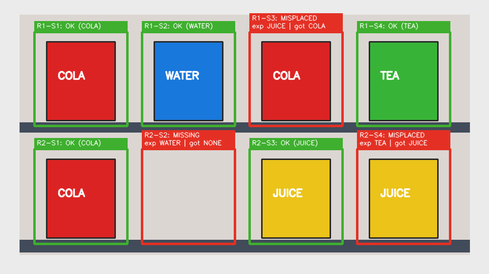

# YOLO & OpenCV Shelf Planogram Compliance POC

A self-contained computer-vision proof of concept that ingests retail shelf images, detects products (`Ultralytics YOLOv8/v11` or deterministic OpenCV HSV detector for offline testing), maps detections against a JSON planogram layout, renders **green (compliant)** / **red (misplaced or missing)** bounding overlays, and exports a CSV mismatch table + HTML compliance dashboard.

> **Note:** Original technical demonstration authored by **Selim Halabi** (Control & Automation M.Sc. candidate, İTÜ | B.Sc. EEE). Synthetic shelf test assets are generated reproducibly by `generate_sample_shelf.py`.

## Output Preview



## Architecture

1. **Pluggable Detection (`ProductDetector` Protocol):**
   - `UltralyticsYOLODetector`: Runs `YOLOv8` / `YOLOv11` inference on real retail shelf images (`yolov8n.pt` or custom-trained SKU weights).
   - `HSVContourSKUDetector`: Deterministic OpenCV color/contour detector for weight-free offline verification and CI tests.
2. **Planogram Zone Comparator (`evaluate_planogram`):**
   - Converts normalized `[x1, y1, x2, y2]` planogram zones from `sample_planogram.json` to pixel coordinates and assigns the highest-IoU detected SKU (`MATCH`, `MISPLACED`, or `MISSING`).
3. **Visual & Tabular Deliverables:**
   - `sample_overlay_result.png` — Green/red compliance bounding boxes with expected vs. detected labels.
   - `planogram_mismatches.csv` — Machine-readable audit table.
   - `dashboard.html` — Standalone HTML summary dashboard with compliance KPIs.

## Quickstart

```bash
pip install -r requirements.txt
python generate_sample_shelf.py
python planogram_checker.py
python -m unittest test_planogram.py -v
```

To run with your own **Ultralytics YOLO** model weights in Python:

```python
from pathlib import Path
from planogram_checker import UltralyticsYOLODetector, run_pipeline

detector = UltralyticsYOLODetector("yolov8n.pt", conf_threshold=0.30)
run_pipeline(Path("sample_shelf.png"), Path("sample_planogram.json"), Path("out"), detector=detector)
```
